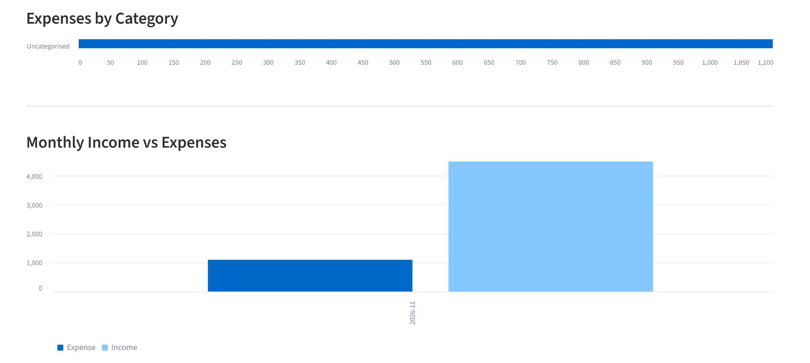

# Personal Finance Tracker

A personal finance management application built using Python, Streamlit, and SQLite. The application allows users to record income and expenses, organise transactions into categories, and monitor their financial activity through an interactive web interface.

## Application Screenshots

### Main Dashboard



### Financial Analytics


## Features

- Add income and expense transactions
- View transaction history and account balances
- Edit and delete existing transactions
- Create, rename, and delete categories
- Categorise income and expenses
- View expenses by category
- Store financial records locally using SQLite

## Technologies Used

- **Python** – Application logic and data processing
- **Streamlit** – Interactive web interface
- **SQLite** – Local database for storing transactions
- **Pandas** – Data handling and presentation

## How to Run

### 1. Clone the repository

```bash
git clone https://github.com/maabdullah97/personal-finance-tracker.git
cd personal-finance-tracker
```

### 2. Create a virtual environment

```bash
python -m venv .venv
```

### 3. Activate the virtual environment

Windows:

```bash
.venv\Scripts\activate
```

macOS/Linux:

```bash
source .venv/bin/activate
```

### 4. Install the required libraries

```bash
pip install -r requirements.txt
```

### 5. Run the application

```bash
python -m streamlit run app.py
```

The application will open in your web browser. A local SQLite database will be created automatically when the application is initialised.

## What I Learned

Through developing this project, I gained practical experience in:

- Building interactive applications with Python and Streamlit
- Designing and working with SQLite databases
- Implementing CRUD operations (Create, Read, Update, Delete)
- Managing and categorising financial data
- Debugging application logic and handling user input
- Organising a Python project for version control

## Future Improvements

- Monthly spending reports and trends
- Budget limits and spending alerts
- CSV import and export functionality
- Additional financial charts and visualisations
- Improved filtering and transaction search

## Project Status

Functional local application with transaction management, category management, and financial summaries.
